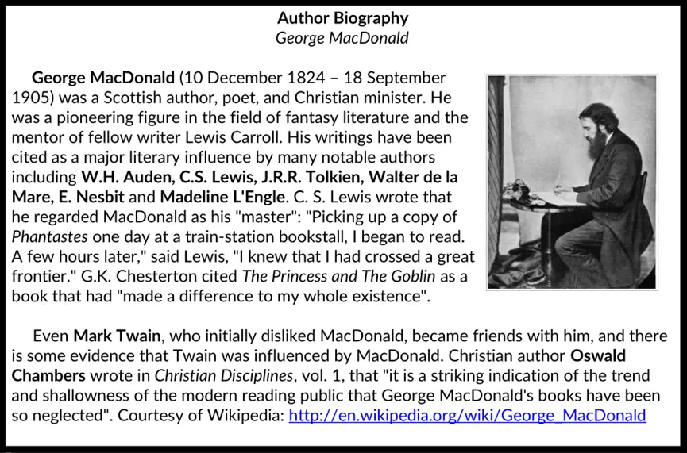
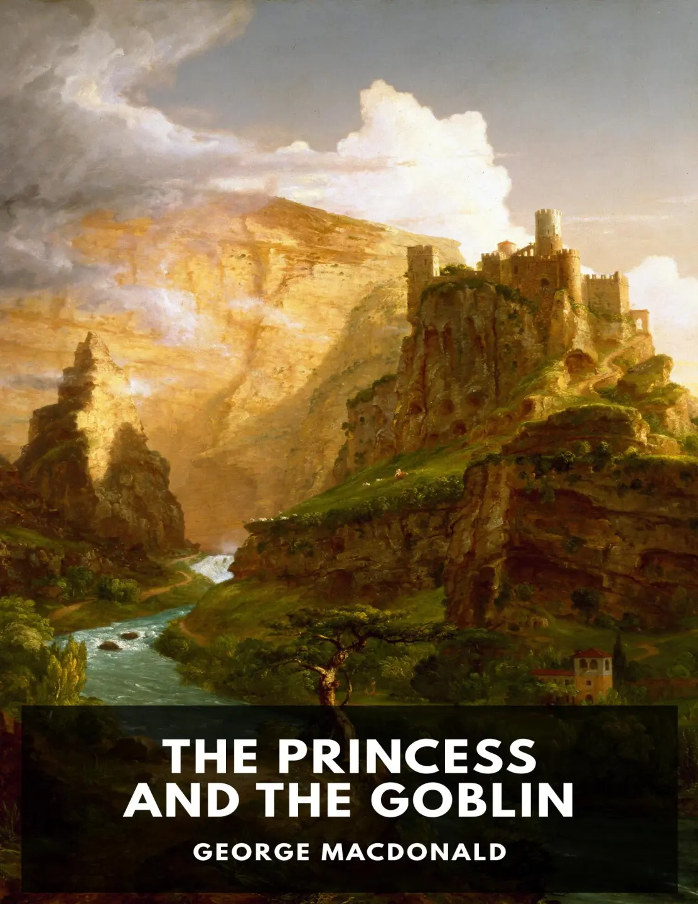
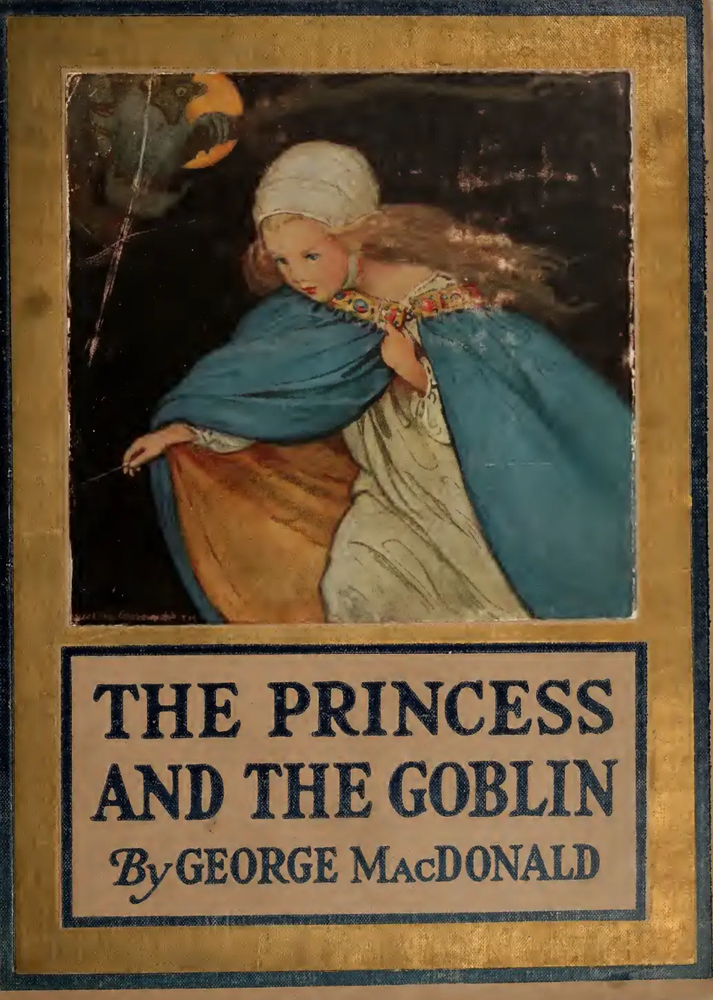

## 被忽视的童话大师，和删去的彩蛋

人们经常说“有眼不识泰山”、“有眼不识金镶玉”，意思是大牛站在你面前，你都认不出来，也就是通俗点说的“不识货”。

其实，日光之下，这样的事，不胜枚举，难怪三千年前智慧的所罗门王早早地感慨：“智慧人和愚昧人一样，永远无人记念，因为日后都被忘记；可叹智慧人死亡，与愚昧人无异。”

乔治·麦克唐纳，你可能从未听说过，就属于这样的一位因大众的不识货（或偏见）而几乎被遗忘的童话大师。我翻译一段他的简介，你就明白了：

乔治·麦克唐纳（1824年12月10日-1905年9月18日）是一位苏格兰作家、诗人和牧师。他是奇幻文学领域的先驱人物，也是同为作家的刘易斯·卡罗尔（Lewis Carroll，最出名的是他的《爱丽丝梦游仙境》）的导师。

麦克唐纳的著作对后世文坛产生深远影响，并被许多知名作家引用，包括奥登、C.S.路易斯、J.R.R.托尔金、沃尔特·德拉马、E.奈斯比特和玛德琳·朗格尔（Madeline L'Engle，顺便提一句，非常推荐她写的A Wrinkle in Time，我曾带学生读过）。

C.S.路易斯在《[乔治·麦克唐纳选集](https://www.fadedpage.com/books/20140910/html.php)》的序言中称麦克唐纳为自己的“师傅”。他回忆，自己曾在书摊上多次看到《幻境》（*Phantastes*），迟迟没有买下；直到终于把书买回去读，他才发现：“几个小时后，我知道自己已跨越一道伟大的边界。”

G.K.切斯特顿在为《乔治·麦克唐纳与妻子》撰写的[序言](https://www.worksofmacdonald.com/george-macdonald-and-his-wife/2023/7/20/excerpt-from-gk-chestertons-introduction-to-george-macdonald-and-his-wife)中称《公主与哥布林》（The Princess and the Goblin）这本书“对我的整个存在产生了影响”。

甚至最初不喜欢麦克唐纳的马克·吐温也和他成了朋友，而且有一些证据表明吐温受到了麦克唐纳的影响。

基督徒作家章伯斯（Oswald Chambers）在《Christian Discipline》第一卷中[写道](https://www.rabbitroom.com/post/proper-introductions-george-macdonald)：“乔治·麦克唐纳的书竟如此遭到冷落，鲜明地暴露出现代读者的阅读趋向与浅薄。”

看完上面的简介，你还会选择去读或给你的孩子去读那些书店里流行却质次的儿童读物吗？

此前一次暑假教学中，我带学生精读麦克唐纳的经典童话《公主与哥布林》的英语原著，没想到还意外发现了彩蛋——拿着网上搜到的旧版与新一些的版本对比，我发现同一本书的不同版本竟有不小的差异。

（上面是我手上的新旧两个版本的封面）

《公主与哥布林》最早于1870年11月至1871年6月在麦克唐纳担任主编的《Good Words for the Young》上连载，1872年出版单行本。早期文本穿插着以斜体标出的对话，仿佛讲故事的人正在与一位小读者交谈。我找到的一个保留这些对话的版本这样开头：

从前有一位小公主，她——

“但是，作者先生，你为什么总是写公主？”

“因为每个小女孩都是公主。”

然而，许多现代通行版本删去了这些对话，甚至有些标榜“未删节”的版本也不例外。删改后的故事这样开始：

“从前有一个小公主，她的父亲是一个多山多谷的大国的国王。”

（被删去的正是开篇这段作者与读者的对话。）

我试译一下这段对话（据 [Project Gutenberg 收录的1920年 David McKay 版](https://www.gutenberg.org/cache/epub/34339/pg34339-images.html)）：

"曾经有一位小公主，她...

"但是作者先生，为什么你总是写公主？"

"因为每个小女孩都是公主。"

"如果你告诉她们这些，你会让她们变得爱慕虚荣。"

"如果她们理解我的意思就不会。"

"那你的意思是什么呢？"

"你说，公主是什么意思呢？"

"就是一位国王的女儿。"

"很好，这样每个小女孩都是公主，就没有必要说什么了，除非她总会忘记自己的地位，行为举止好像自己是从泥巴里长出来似的。我见过有些小公主的行为像小偷和谎话连篇的乞丐的孩子，这就是为什么要去告诉她们是公主的原因。这就是为什么当我讲这样故事时，我喜欢讲一个公主的故事。这样我就能更好地说出我的意思，因为这样我就能把我所希望她拥有的每一件美物都送给她了。"

“请继续讲吧。”

*版本附记：这份译文所据的1920年版在开篇使用“Mr. Author”（作者先生）；学者 [Aubrey Plourde](https://www.cambridge.org/core/journals/victorian-literature-and-culture/article/george-macdonalds-doors-suspended-telos-and-the-child-believer/2BE883E8862D7E01C47EAC281EDFA4A0) 引用的早期连载文本则使用“Mr. Editor”（编辑先生）。两种称呼的具体修订经过仍需进一步校勘。*

…

所以，亲爱的 Pilgrim，你是不是也突然明白了什么？这几句看似随意的对话，竟是理解故事的一把钥匙。

在麦克唐纳笔下，公主的高贵不只在于出身，更在于举止是否与身份相称。每个小女孩都需要有人提醒她：别忘了自己是谁。这让我想到基督教信仰中关于人的尊严与生命成长的观念。当然，童话的隐喻不能直接当作神学教义；但麦克唐纳的信仰，确实使这段妙趣横生的开场多了一层意味。

更有意思的是，被删掉的可不止这一处。第三章，艾琳遇见坐在纺车前的老妇人，小读者忍不住插嘴：“这不就是《睡美人》吗？”叙述者竟和她争辩起来。到了最后一章，小读者又追问艾琳和柯迪后来的故事，叙述者却拒绝给出一个彻底完结的答案：哪有故事真的讲得完呢？

原来，这些“插话”不是游离于故事之外的闲笔。麦克唐纳不只在给孩子讲童话，也邀请孩子走进故事，与他对话、质疑、思考。

可是，这些对话为什么消失了？

2014年的一项[研究](https://doi.org/10.17077/etd.z68aojto)指出，1888年 Blackie & Son 出版的新版已删去这三处对话；那时麦克唐纳仍然在世。究竟是他自己改变了主意，还是出版商或编辑做了删改？目前尚无足够证据作出定论。

删去这些对话，故事也许更流畅；但我们同时失去了一位愿意停下故事、认真和孩子说话的叙述者。

对我来说，这才是最可惜的地方。**好的童话不只是让孩子听完一个故事，还邀请他们学会在故事里思考。**

至于当初究竟是谁决定让这些声音消失——你会怎么看？

### 版本与参考资料

- [《公主与哥布林》出版书目](https://www.victorianresearch.org/atcl/show_title.php?tid=8813)：最初连载时间（1870–1871）与1872年单行本。
- Johanna Ruth Brinkley Tomlinson, [*Playing with Words: Child Voices in British Fantasy Literature 1749–1906*](https://doi.org/10.17077/etd.z68aojto)（爱荷华大学博士论文，2014），尤其是第95–97页：早期文本的对话设计与1888年 Blackie & Son 新版的删节。
- Aubrey Plourde, [*George MacDonald's Doors: Suspended Telos and the Child Believer*](https://www.cambridge.org/core/journals/victorian-literature-and-culture/article/george-macdonalds-doors-suspended-telos-and-the-child-believer/2BE883E8862D7E01C47EAC281EDFA4A0)（*Victorian Literature and Culture*，2021）：讨论原始文本中开放式结尾的文学与神学意义。
- [关于不同版本删节问题的早期讨论](https://scifi.stackexchange.com/questions/124811/reason-for-differences-in-princess-and-the-goblin-editions)（2016），可与以上书目研究对照。

