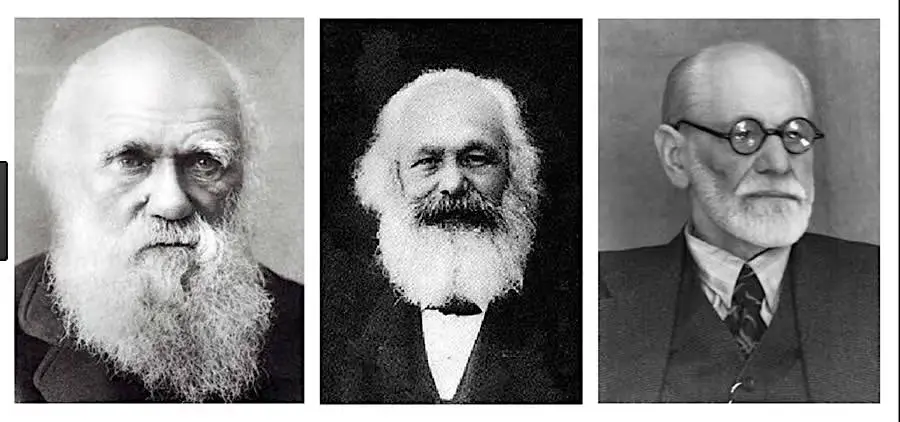
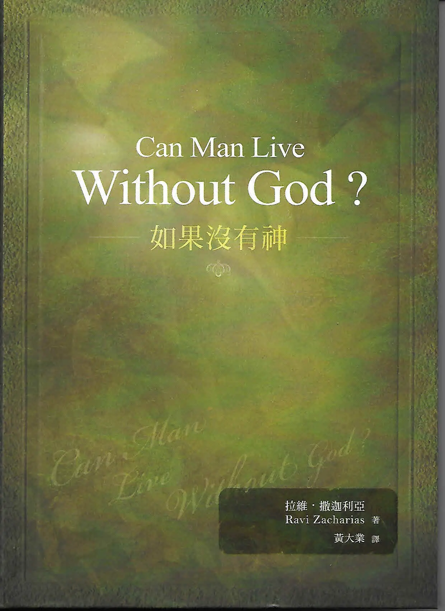

## 讽刺诗《（现代人的）信条》 - 史蒂夫·特纳

《（现代人的）信条》

作者：史蒂夫·特纳

翻译：张云轩

我们信仰马克思弗洛伊德达尔文。

我们相信一切都可行，

前提是别伤害任何人，

就是尽你所知，按着

你对伤害的定义即可。

我们信仰婚前、婚后，以及婚外的性行为。

我们信仰“罪恶娱乐疗法”。

我们相信红杏出墙别有生趣。

我们相信鸡奸也无伤大雅。

我们最忌讳把一些事当成忌讳。

我们相信万物都不断进步，

尽管有相反的证据。

你必须把这证据调查清楚，

毕竟你能用证据证明任何东西。

我们相信星座运势、外星飞碟、

念力弯勺都有个中奥秘。

耶稣是个好人，就像佛祖、

默罕默德和我们自己一样。

他是个不错的道德老师，

虽然我们认为他的道德教训差强人意。

我们相信所有宗教大同小异

至少我们所信的看来如此。

它们都追求爱和良善。

它们的差别不过在于创造、

罪、天国、地狱、上帝和救赎。

我们相信死后便是虚无，

因为你若去求问死人，

沉默便是他们的回答。

倘若死人向你撒了谎，倘若死亡并非终点，

那么天国必是众人的归宿，

也许除了

希特勒、斯大林和成吉思汗。

我们信仰Masters & Johnson 的性学研究。

研究对象挑选普通人，

普通的就是正常的，

正常的就是好的。

我们相信全面裁军，

我们相信战争和杀戮有直接联系。

美国人应该把他们的枪打成拖拉机，

而俄国人定会效仿。

我们相信人在本质上是好的，

只是他的行为让他失望。

这是社会的过错，

社会的过错乃是形势所迫，

形势的过错乃是社会所迫。

我们相信每个人都应该找到

自己眼中看为正确的真理。

现实会随之自圆其说，

整个宇宙会重新调整，

历史也会改头换面。

我们相信世上没有绝对的真理，

除了“没有绝对真理”这条真理。

我们信仰对诸般信条的摒弃，

要让个人思想百花齐放。

《机运》 – 后记

如果“机运”

是众生之父，

那么，灾难就是他在空中立约的彩虹，

而当你听到：

“全国戒备！

狙击手击毙十人！

军队残杀平民！

白人屠杀劫掠！

学校遭炸弹袭击！”

此乃人膜拜造他的主

所发出的声音。

_

史蒂夫·特纳（Steve Turner）, 英国记者， 《信条》一诗写于1993年，是他对现代思想的讽刺诗

该诗引用自拉维‧撒迦利亚（Ravi Zacharias）的书

---

**编者延伸阅读**　特纳在诗的第一行把马克思、弗洛伊德和达尔文的名字连成一串。克里夫特也把这三人并列，却从一个更古老的问题说起：人为什么愿意相信，自己的过错早已写在星辰里？参读[《占星术之惑，及其三种现代版本》](https://reasonforhim.com/zh/augustine-confessions-astrology-confusion-three-modern-versions/)。

